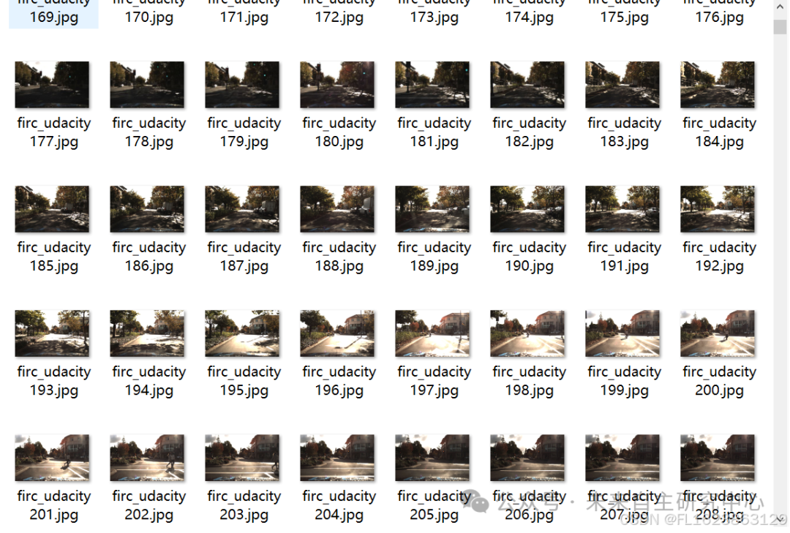
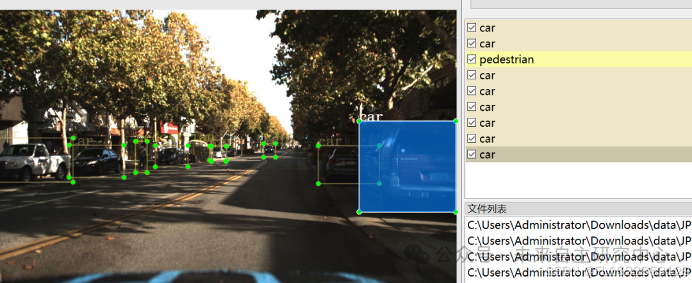

# [Dataset] [Object Detection] Udacity Traffic Object Detection Dataset VOC+YOLO format with 13063 images in 11 categories

Important Notice: The dataset is smaller than the actual Udacity dataset due to errors in annotation, such as empty labels. These have been removed. You can safely download and train your own model without worrying about issues. The dataset has been automatically repaired and validated by me to ensure compliance with the VOC annotation standards.
Dataset format: Pascal VOC format + YOLO format (txt file without split path, only containing jpg images and corresponding VOC format xml files and yolo format txt files)
Number of images (number of jpg files): 13063
Number of annotations (number of xml files): 13063
Number of annotations (number of txt files): 13063
Labeling category count: 11
Label category names: ["biker", "car", "pedestrian", "trafficLight", "trafficLight-Green", "trafficLight-GreenLeft", "trafficLight-Red", "trafficLight-RedLeft", "trafficLight-Yellow", "trafficLight-YellowLeft", "truck"]
Number of boxes labeled in each category:

| Serial Number || Category Name || Box Count |

| 1 || biker || 1676 |
| 2 || car || 60788 |
| 3 || pedestrian || 9866 |
| 4 || trafficLight || 2560 |
| 5 || trafficLight-Green || 5497 |
| 6 || trafficLight-GreenLeft || 305 |
| 7 || trafficLight-Red || 6859 |
| 8 || trafficLight-RedLeft || 1754 |
| 9 || trafficLight-Yellow || 264 |
| 10 || trafficLight-YellowLeft || 14 |
| 11 || truck || 3503 |
| Total || 11 || 93086 |

Using labelImg:

Annotation rules: Rectangular boxes are drawn around categories.
Special Notice: This dataset does not guarantee the accuracy or precision of the trained models or weight files, and only provides accurate and reasonable annotations.
Image preview:

Annotation example:

## Payment

Here is a pay link on Stripe ( https://buy.stripe.com/3cs8yP7sY87d0vu9AB ). Please contact me lonlonago@foxmail.com after funding $89, and I will send you a complete data files , thank you!

